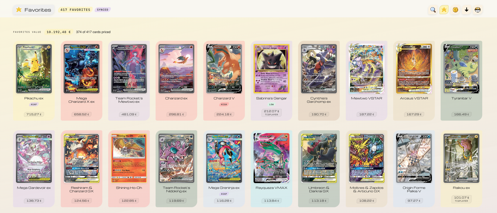

# inv

A Pokémon TCG card browser. Pick an era, pick a set, get the cards with current market prices
from [TCGdex](https://tcgdex.dev). Or browse by Pokémon, or by illustrator, and star cards to keep
them in a favorites list that follows you across devices once you sign in.

Live at [inv.siffert.io](https://inv.siffert.io)

<p align="center">
  
</p>

## About this project

This is an old weekend project. It started as an attempt at a mobile-first website and turned into a
card list somewhere along the way. It is not actively maintained and I do not care for it much — I
had an AI rework it so it is not quite as bad as it was. Expect rough edges.

inv is an unofficial fan project. It is not affiliated with, endorsed by or sponsored by Nintendo,
The Pokémon Company, Creatures, Game Freak, Cardmarket or TCGplayer. Pokémon and all related names
and images are trademarks of their respective owners.

## Running it

```
npm install
npm run fetch-data
npm run dev
```

The site does not call the TCGdex API from the browser. It reads a snapshot of all sets and cards
from `data/`, which `npm run fetch-data` downloads through the public TCGdex API. Run it once before
starting the dev server. TCGdex needs no API key. Prices are only available per card, so a run
requests every card individually and takes a while. Pokémon TCG Pocket sets are skipped, as they
have no market prices.

Sign-in works out of the box against the Firebase project named in `.env`. For your own project,
see [Accounts](#accounts).

## Scripts

```
npm run dev            # dev server on :3030
npm run build          # typecheck, then production build into dist/
npm run start          # serve dist/ on 127.0.0.1:3030 behind nginx (what the server runs)
npm run preview        # serve dist/ on localhost only
npm run fetch-data     # refresh the set and card snapshot in data/
npm run build-indexes  # rebuild pokemon, artist and search indexes from the card files, no network
npm run typecheck      # tsc for the app and for vite.config.ts
npm run lint           # eslint
npm run format         # prettier
```

A pre-commit hook runs the formatter and linter.

## Deploying

The server runs `npm start`, which serves the **built** output from `dist/`. Build before
restarting, or there will be nothing to serve:

```
git pull
npm install
npm run build
pm2 restart inv
```

`data/` lives outside `dist/`, so a rebuild keeps the snapshot. Refresh it daily with a pm2 cron job,
started once from the repository directory on the server:

```
pm2 start npm --name inv-fetch-data --cron-restart "0 4 * * *" --no-autorestart -- run fetch-data
pm2 save
```

Each file is written to a temporary path and renamed into place, so the site keeps serving the
previous data while a refresh runs, and a failed set keeps its previous file.

`.env` is tracked and holds the public Firebase config. Server-only overrides go into `.env.local`,
which git ignores and Vite loads on top.

`npm run dev` is for local work only. Do not run it as the public server: it ships unbundled source,
and its hot-reload WebSocket makes phones prompt for local network access.

## How it works

- **React + Vite + TypeScript**, SCSS modules for styling.
- **Snapshot** in `data/`: `sets.json` holds every set plus `generatedAt` (when prices were
  fetched), `indexedAt` (when the card files and indexes were last written) and `eurPerUsd`, the ECB
  reference rate used to compare TCGplayer prices with Cardmarket ones. `cards/<setId>.json` holds
  each set's cards sorted by trend price. `pokemon.json` and `artists.json` index the same cards by
  Pokémon and by illustrator, with per-entry card files under `pokemon/` and `artists/`. A small
  Vite plugin serves the directory under `/data` in both `dev` and `preview`.
  `npm run build-indexes` regenerates the indexes from the card files already on disk, which is
  enough after a change to the index shape.
- **TanStack Query** fetches the snapshot and persists it to IndexedDB so a revisit is instant.
  Card and index queries are keyed by `indexedAt`, so any rebuild drops the old copies. The
  persisted cache carries a `buster` string in `main.tsx`; bump it whenever the shape of `sets.json`
  or the card files changes.
- **Modes**: the toggle top left cycles Sets, Pokémon and Artists, and reads Favorites while you are
  there. Each mode remembers its last page.
- **Search** filters the list you are on. "All cards named …" opens `/search?q=` with every matching
  card across every set, built from `data/search.json`.
- **Links**: the selected set and the open card live in the URL (`/market?set=<setId>&card=<cardId>`),
  so they can be shared.
- **Prices** come from TCGdex, which mirrors the Cardmarket and TCGplayer price guides. A card
  without a Cardmarket price shows its TCGplayer market price instead, in USD and tagged as such.
  Card details show a table with a row per printing and a column per marketplace, linking to each
  product page. Prices can be older than the snapshot; each card shows when its price was last
  updated.
- **Variants**: the snapshot keeps which printings a card has (holo, reverse, 1st edition) and, where
  TCGdex names it, the holo pattern. The search box matches them, so "cosmos" finds the cosmos holos
  of a set.
- **Card grids** use `content-visibility: auto` so off-screen tiles cost almost nothing, and images
  load lazily with their aspect ratio reserved.
- **Theming** is a `data-theme` attribute on `<html>`, stored in `localStorage` and falling back to
  the OS preference. An inline script in `index.html` applies it before first paint.
- **Favorites** live in `localStorage` for guests and in Firestore for signed-in users. Firebase is
  loaded lazily, so guests never download it.

## Accounts

Sign-in is Google only, through Firebase Auth. It exists solely to sync favorites across devices.
No profile data is stored; the account id is the only thing that reaches the database.

The Firebase web config lives in `.env` as `VITE_FIREBASE_*` keys. Those values are public by
design; access is controlled by `firestore.rules`.

To set up a new Firebase project:

1. Create a project, add a Web app, and copy its config into `.env`.
2. Authentication → Sign-in method: enable Google. Authentication → Settings: add the site domain
   to the authorized domains.
3. Firestore: create a database (Standard edition, production mode).
4. Deploy the rules:

```
npx firebase-tools login
npx firebase-tools deploy --only firestore:rules
```

`.firebaserc` names the project and `firebase.json` points at the rules file.

### How favorites are stored

One document per user at `users/<uid>`, with a single field, `favorites`, a map keyed by card id:

```json
{
  "favorites": {
    "sv03-125": { "setId": "sv03", "addedAt": 1762436400000 },
    "swsh4-25#Cracked Ice Holo": {
      "setId": "swsh4",
      "addedAt": 1762438000000,
      "cardId": "swsh4-25",
      "print": "Cracked Ice Holo"
    }
  }
}
```

`setId` tells the favorites page which card files to load, `addedAt` keeps the order. A favorite for
one specific printing is keyed `cardId#print`.

- **Writes**: starring is a `setDoc` with `merge: true` on that one key, unstarring an `updateDoc`
  with `deleteField()`. There is no read-modify-write, so two devices never overwrite each other.
- **Reads**: one `onSnapshot` listener on the document while signed in.
- **Offline**: Firestore's persistent cache is enabled, so toggles work without a connection and
  sync when it returns.
- **Rules**: a user may read and write only `users/<their own uid>`, and only when the document holds
  exactly one key, `favorites`, holding a map.
- **Merge**: on the first sign-in on a device that already has guest favorites, a dialog offers to
  add them to the account.

Code: `src/util/ui/favorites/cloudFavorites.ts` holds the Firestore calls,
`FavoritesProvider.tsx` next to it switches between local and cloud and runs the merge,
`src/util/firebase/app.ts` initialises the SDK.

### Admin

A single admin role, granted by hand in the Firebase Console by creating `roles/<uid>` with
`admin: true`. Nobody can write roles from the app. Documents under `config/` are readable by
everyone and writable only by admins. `src/util/admin/AdminProvider.tsx` exposes `isAdmin` through
`AdminContext`.

## Known gaps

- There is no test suite.
- Prices are whatever TCGdex reports and are not validated.
- A card removed from the account can be offered again by the merge dialog on a device that still
  holds it as a guest favorite.
